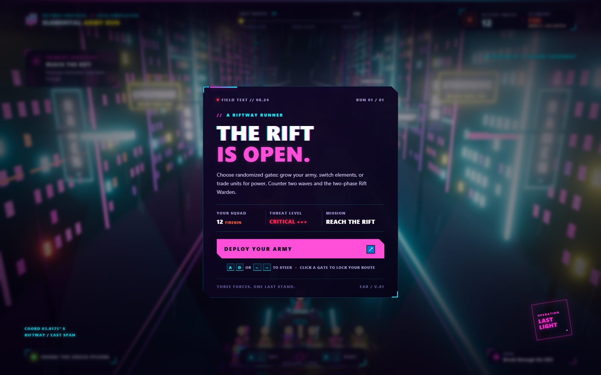

# Elemental Army Run — Riftway Protocol

> **Topik UTS:** Elemental Army Run  
> **Jenis proyek:** mini-game runner 3D berbasis browser

## Deskripsi

Pimpin pasukan Fire, Water, atau Electric melintasi Ashen Causeway. Pilih gate untuk mengubah jumlah dan elemen pasukan, hindari shock pylon, lalu hadapi Shadow Guard dan Rift Warden.

## Anggota dan kontribusi

| Anggota | NRP | Kontribusi |
| --- | --- | --- |
| Mario Napitupulu | 5025241085 | Scene dan environment, gate, formasi pasukan, model GLTF, serta HUD |
| Nathanael Oliver Amadhika Yuswana | 5025241109 | Gameplay, battle, state permainan, elemental VFX, HUD, serta kontribusi scene dan environment |

## Gameplay dan tujuan

Mulai dengan 12 Firekin. Pasukan berlari otomatis sementara pemain memilih jalur, mengambil bonus, dan menghindari hazard. Ada sembilan pasang gate di sepanjang rute; isi, nilai, dan posisi gate diacak setiap run. Bonus hanya berlaku jika pusat formasi masuk ke bukaan gate. Gate yang sudah dilewati tetap terlihat redup sebagai jejak rute.

**Alur permainan:** Deploy → bergerak dan memilih gate → menghindari hazard → dua wave battle → Rift Warden → menang atau kalah.

### Pilihan gate

| Gate | Dampak |
| --- | --- |
| Fire Recruit | Tambah 4–7 Fire dan 1 power. |
| Electric Recruit | Tambah 4–7 Electric dan 1–3 power. |
| Convert Water | Ubah elemen ke Water, tambah 1–3 ward dan 1 power. |
| Convert Electric | Ubah elemen ke Electric dan tambah 2–4 power. |
| Multiply | Gandakan jumlah pasukan. |
| Divide Army | Bagi dua jumlah pasukan, dibulatkan ke bawah; minimal 1 unit. |
| Rift Tax | Kurangi 3–6 unit. |
| Blood Pact | Tukar 2–4 unit dengan 4–7 power dan ubah elemen ke Fire. |
| Unstable Clone | Gandakan pasukan tiga kali, lalu recoil mengurangi 28–42% hasil clone. |
| Water Bargain | Tukar 2–4 unit dengan 2–3 ward, 2–4 power, dan elemen Water. |

Isi gate dan efeknya terlihat pada papan sebelum dipilih. Karena ada bonus dan penalti, pemain perlu mempertimbangkan jumlah pasukan, elemen, dan kondisi rute.

### Elemen dan battle

Elemen memiliki hubungan counter: **Fire mengalahkan Water, Water mengalahkan Electric, dan Electric mengalahkan Fire.** Counter memberi bonus kekuatan, sedangkan memilih elemen yang dikalahkan musuh memberi penalti.

Setiap elemen juga punya kemampuan khusus: Fire mendapat bonus dasar battle 25%, ward Water membantu menahan pylon dan mengurangi korban, sedangkan Electric dapat mematikan pylon dan mempercepat battle. HUD menampilkan elemen lawan dan kelemahannya.

Battle menampilkan musuh yang muncul dari portal, serangan energi bergantian, partikel impact, guncangan kamera, dan health bar. Rift Warden memiliki dua fase: shield-nya pecah di tengah battle, membuka core Water dan mempercepat serangannya. Pasukan menang jika kekuatannya cukup untuk mengalahkan musuh; jika gagal dalam battle, permainan berakhir dengan lose state. Pilih **Run It Back** atau tekan <kbd>R</kbd> setelah hasil untuk memulai ulang dengan susunan gate baru.

## Kontrol

| Input | Aksi |
| --- | --- |
| <kbd>A</kbd> / <kbd>D</kbd> atau tombol panah kiri/kanan | Pindah jalur. |
| Tombol **LEFT** / **RIGHT** pada HUD | Pindah jalur dengan mouse atau layar sentuh. |
| Klik panel gate | Memilih jalur gate. |
| **Deploy Your Army** atau <kbd>Enter</kbd> / <kbd>Space</kbd> | Memulai permainan. |
| Tombol **PAUSE** atau <kbd>P</kbd> / <kbd>Esc</kbd> | Jeda atau lanjutkan permainan. |
| **Run It Back** atau <kbd>R</kbd> setelah hasil | Memulai ulang permainan. |

## Fitur grafika dan interaksi

- **Scene dan kamera:** scene Three.js dengan kamera perspektif third-person, jalan, reruntuhan, starfield, dan fog.
- **Environment prosedural:** langit dibuat dengan <code>CanvasTexture</code>; kota, jalan, gate, pantulan cahaya, dan rintik hujan dibangun di <code>main.js</code>.
- **Model dan material:** prajurit low-poly GLTF buatan project dengan struktur parent–child. Material PBR membedakan Fire, Water transparan, dan Electric emissive.
- **Crowd dan animasi:** leader mengatur formasi pasukan; maksimal 24 model dirender agar tetap ringan. Animasi meliputi lari unit, gate dan portal, pylon, boss, serta serangan battle.
- **Cahaya dan bayangan:** beberapa lampu, shadow map, object yang cast shadow, dan permukaan yang menerima shadow.
- **Interaksi:** kendali jalur, pilihan gate dengan <code>THREE.Raycaster</code>, serta penghindaran hazard.
- **VFX dan feedback:** partikel api, gelembung Water, electric arc, portal glow, shockwave, flash saat terkena efek, dan health bar battle.
- **HUD dan game state:** jumlah unit, elemen, tujuan, progress rute, feedback battle, win/lose state, dan restart.

## Struktur project

    Praktikum-UTS/
    ├── .github/workflows/deploy.yml   # Deploy GitHub Pages
    ├── assets/
    │   ├── build-ember-captain.ps1    # Generator model karakter
    │   ├── ember-captain.bin          # Data geometri model
    │   ├── ember-captain.gltf         # Model karakter
    │   └── favicon.svg
    ├── screenshots/screenshot.png     # Screenshot project
    ├── .nojekyll
    ├── index.html                     # Halaman, HUD, dan layar game
    ├── main.js                        # Scene, gameplay, animasi, dan VFX
    ├── style.css                      # Tampilan dan layout responsif
    └── README.md

## Cara menjalankan

Project menggunakan ES modules dan memuat Three.js 0.169.0 dari jsDelivr. Koneksi internet diperlukan agar Three.js dan font dari CDN dapat dimuat.

1. Buka folder <code>Praktikum-UTS</code> di VS Code dan jalankan **Live Server** pada <code>index.html</code>; atau buka terminal di folder tersebut, lalu jalankan:

       python -m http.server 8000

2. Buka [http://localhost:8000](http://localhost:8000) di browser desktop.
3. Tunggu loading selesai, lalu pilih **Deploy Your Army**.

Jangan membuka <code>index.html</code> langsung dengan <code>file://</code>. Browser perlu HTTP lokal untuk memuat ES modules dan model GLTF.

## Deploy ke GitHub Pages

Workflow <code>.github/workflows/deploy.yml</code> menerbitkan isi folder ini setiap kali ada push ke branch <code>main</code>. Untuk konfigurasi awal, buka **Settings → Pages** di repository dan pilih **GitHub Actions** sebagai sumber deploy.

Situs: [kenzy-tc.github.io/Grafkom-Project-ETS](https://kenzy-tc.github.io/Grafkom-Project-ETS/)

## Tantangan implementasi

- Menjaga pilihan gate dengan Raycaster tetap selaras dengan perpindahan jalur selama pasukan berlari otomatis.
- Menyeimbangkan reward dan penalti gate, hazard, dua wave musuh, serta boss agar pilihan pemain berpengaruh.
- Menampilkan hingga 24 karakter dari satu model GLTF sambil menjaga animasi dan perubahan elemen tetap sinkron.

## Kredit aset

| Asset | Sumber dan lisensi |
| --- | --- |
| Karakter <code>ember-captain.gltf</code> dan <code>ember-captain.bin</code> | Dibuat secara prosedural untuk project; generator ada di <code>assets/build-ember-captain.ps1</code>. Tidak memakai model atau gambar eksternal. |
| Three.js 0.169.0 dan GLTFLoader | [Three.js](https://github.com/mrdoob/three.js), lisensi MIT; dimuat dari jsDelivr CDN. |
| Font Chakra Petch dan Orbitron | Chakra Petch oleh Cadson Demak dan para kontributor; Orbitron oleh Matt McInerney. Keduanya dari [Google Fonts](https://fonts.google.com/) dan memakai [SIL Open Font License 1.1](https://openfontlicense.org/). |
| Background, efek, dan UI | Dibuat oleh project: sky procedural, kota, jalan, gate, partikel, tekstur portal, boss, dan antarmuka. |

## Screenshot

Contoh tampilan lainnya: [Gameplay](screenshots/Gameplay.png) · [Enemy](screenshots/Enemy.png) · [Boss](screenshots/Boss.png) · [Pause](screenshots/Pause.png) · [End](screenshots/End.png).
